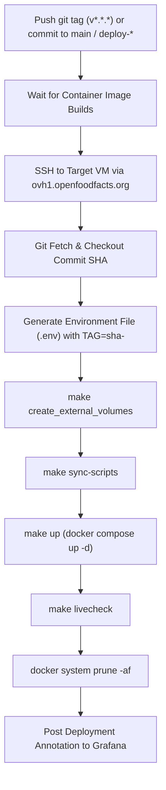

# Search-a-licious Release and Maintenance Guide

This document details the release process, CI/CD pipeline, and routine/operational maintenance tasks (including index rebuilding, taxonomy updates, script synchronization, and index cleanup) for Search-a-licious.

---

## Table of Contents

- [Environments \& Architecture](#environments--architecture)
- [Release Process](#release-process)
  - [1. Conventional Commits Requirement](#1-conventional-commits-requirement)
  - [2. Automated Release via Release-Please](#2-automated-release-via-release-please)
  - [3. Container Image Build](#3-container-image-build)
  - [4. Deployment Workflow](#4-deployment-workflow)
  - [5. Manual Deployment \& Hotfixes](#5-manual-deployment--hotfixes)
  - [6. Post-Release Verification](#6-post-release-verification)
  - [7. Rollback of an Application Release](#7-rollback-of-an-application-release)
- [Maintenance Tasks](#maintenance-tasks)
  - [Index Architecture (Aliases \& Zero-Downtime Swaps)](#index-architecture-aliases--zero-downtime-swaps)
  - [Task 1: Full Index Rebuild (Reindexing)](#task-1-full-index-rebuild-reindexing)
  - [Task 2: Rollback to a Previous Index](#task-2-rollback-to-a-previous-index)
  - [Task 3: Partial Index Updates](#task-3-partial-index-updates)
  - [Task 4: Taxonomy Import \& Synonym Generation](#task-4-taxonomy-import--synonym-generation)
  - [Task 5: Synchronizing Elasticsearch Scripts](#task-5-synchronizing-elasticsearch-scripts)
  - [Task 6: Cleaning Up Obsolete / Orphan Indexes](#task-6-cleaning-up-obsolete--orphan-indexes)
  - [Task 7: Managing the Continuous Update Daemon](#task-7-managing-the-continuous-update-daemon)
  - [Task 8: Cluster Health \& Monitoring](#task-8-cluster-health--monitoring)
- [Operational Runbook Summary](#operational-runbook-summary)

---

## Environments & Architecture

Search-a-licious runs across two primary remote environments in addition to local development:

| Environment | Host / VM | Trigger | External Base URL | Notes |
|-------------|-----------|---------|-------------------|-------|
| **Staging** | `off-search-net` (VM: `10.1.0.200`) | Pushes to `main` or `deploy-*` | `https://world.openfoodfacts.net` | Shared `po_webnet` docker network with Product Opener staging. |
| **Production** | `off-search-org` (VM: `10.1.0.201`) | Git tags `v*.*.*` | `https://world.openfoodfacts.org` | Product Opener runs on a dedicated host; Redis is accessed via stunnel VM (`10.1.0.113`). |

Access to both environments is proxied via SSH through bastion `ovh1.openfoodfacts.org` with user `off`.

---

## Release Process

### 1. Conventional Commits Requirement

Every pull request merged into `main` must adhere to the [Conventional Commits specification](https://www.conventionalcommits.org/). This is validated on each PR by the `.github/workflows/semantic-pr.yml` workflow.

Standard commit prefixes:
- `feat:` – Introduces a new feature (triggers a **minor** version bump).
- `fix:` – Fixes a bug (triggers a **patch** version bump).
- `feat!:` or `fix!:` or `BREAKING CHANGE:` – Introduces breaking changes (triggers a **major** version bump).
- `docs:`, `style:`, `refactor:`, `test:`, `chore:` – Maintenance tasks (documented in CHANGELOG under *Technical*).

### 2. Automated Release via Release-Please

Release management is automated with [Google release-please](https://github.com/googleapis/release-please) configured in `.github/workflows/release-please.yml`:

1. Whenever changes land on `main`, the `release-please` action analyzes conventional commit history since the previous tag.
2. It automatically creates or updates an open pull request titled:  
   `chore(main): release X.Y.Z`  
   This PR updates [CHANGELOG.md](file:///Users/pierre/development/search-a-licious/CHANGELOG.md) with classified changelog entries and bumps the version.
3. **To trigger a release**: Review the Release PR and merge it into `main`.
4. Upon merging the Release PR:
   - `release-please` automatically publishes a new GitHub Release.
   - It tags the repository with the new semantic version (e.g. `v1.5.0`).

### 3. Container Image Build

When a semantic version tag (`v*.*.*`), `main`, or `deploy-*` is pushed, the `.github/workflows/container-build.yml` workflow triggers:
- Builds two Docker images using Buildx:
  1. `search_service_image`: Python FastAPI backend and CLI runtime (`Dockerfile` with `runtime` target).
  2. `search_front_image`: Lit/TypeScript web components and Nginx frontend (`frontend/Dockerfile` with `frontend` target).
- Images are published to the GitHub Container Registry (`ghcr.io/openfoodfacts/search-a-licious/...`) with:
  - `{{version}}` (for tags)
  - `sha-<commit_sha>`
  - Branch name tags

### 4. Deployment Workflow

The deployment workflow is defined in `.github/workflows/container-deploy.yml`:



1. **Target Selection**:
   - Tags `v*.*.*` deploy to `off-search-org` (Production).
   - Commits to `main` or branches matching `deploy-*` deploy to `off-search-net` (Staging).
2. **Execution Steps**:
   - Clones or fetches the repository into the environment directory (`off-search-net` or `off-search-org`).
   - Writes production `.env` pointing to the exact image tag `TAG=sha-<sha>` and compose file chain (`docker-compose.yml;docker/prod.yml;docker/monitor.yml`).
   - Ensures persistent external volumes (`esdata01`, `esdata02`) exist via `make create_external_volumes`.
   - Syncs Elasticsearch scripts with `make sync-scripts`.
   - Starts or recreates containers with `make up`.
   - Verifies all services are running with `make livecheck`.
   - Reclaims disk space on host with `docker system prune -af`.
   - Posts deployment metrics and links to Grafana.

### 5. Manual Deployment & Hotfixes

#### Deploying a Preview / Staging Branch
If you want to test changes on staging before merging into `main`:
```bash
git checkout -b deploy-my-feature
git push origin deploy-my-feature
```
This triggers staging deployment to `off-search-net`. Once tested, delete the branch:
```bash
git push origin --delete deploy-my-feature
```

#### Manual Hotfix Release
If an emergency fix is required directly on production without waiting for standard PR cycles:
1. Create and merge the fix branch into `main`.
2. Ensure tests pass.
3. Tag the commit manually with the new semantic version (following existing tags):
   ```bash
   git tag v1.4.1
   git push origin v1.4.1
   ```
4. GitHub Actions will build containers and deploy immediately to `off-search-org`.

### 6. Post-Release Verification

After any deployment, verify the deployment status:
1. **GitHub Action Status**: Verify the `Container Image Deployment CI` workflow run completed with success.
2. **API Health Endpoint**:
   ```bash
   curl -f https://world.openfoodfacts.org/health
   # Or staging:
   curl -f https://world.openfoodfacts.net/health
   ```
3. **Container State**:
   On the target host:
   ```bash
   cd off-search-org  # or off-search-net
   make livecheck
   docker compose ps
   ```
4. **Log Inspection**:
   ```bash
   docker compose logs --tail=100 -f api updater
   ```

### 7. Rollback of an Application Release

If a newly deployed container version causes regressions:

1. **Quick Rollback via Target Host**:
   SSH into the target host, check out the previously working commit SHA, and restart:
   ```bash
   cd off-search-org
   git checkout <PREVIOUS_COMMIT_SHA>
   # Update TAG in .env to the previous SHA
   sed -i 's/^TAG=sha-.*/TAG=sha-<PREVIOUS_COMMIT_SHA>/' .env
   make up
   make livecheck
   ```
2. **Git Revert**:
   On your development machine, revert the problematic commit and push to `main` (or tag a new patch release).

---

## Maintenance Tasks

### Index Architecture (Aliases & Zero-Downtime Swaps)

Search-a-licious utilizes Elasticsearch index aliases to achieve **zero-downtime reindexing and atomic rollbacks**:

- Real index names contain a timestamp suffix:  
  `<index_name>-YYYY-MM-DD-HH-MM-SS-ffffff` (e.g. `off-2024-07-25-14-30-22-123456`).
- Applications query the **alias** (e.g. `off`, `taxonomies`).
- When a full reindex occurs:
  1. A new timestamped index is created.
  2. Data is imported and Redis updates are replayed.
  3. `update_alias` atomically removes the alias from the old index and adds it to the new index in a single Elasticsearch operation.
  4. The old index remains intact on disk, allowing immediate rollback if needed.

---

### Task 1: Full Index Rebuild (Reindexing)

#### When is a Full Rebuild Needed?
- Changes in the configuration file `data/config/openfoodfacts.yml`:
  - Modifying field definitions, data types, or mappings (`fields`).
  - Adding or changing Elasticsearch analyzers, tokenizers, or normalizers.
  - Changes to the preprocessor or data extraction pipeline.
- Major taxonomy or synonym changes (`max_synonyms_entries` modifications).
- Periodic full sync with the source database dump (e.g., Open Food Facts daily/monthly JSONL exports).
- Elasticsearch index corruption recovery.

#### Step 1: Pre-requisites & Resource Verification
1. Ensure the host has adequate disk space (at least 2x the current index size to hold both old and new indices simultaneously):
   ```bash
   df -h /mnt /var/lib/docker
   curl -s localhost:9200/_cat/indices?v
   ```
2. Verify Elasticsearch cluster health is `green` or `yellow`:
   ```bash
   curl -s localhost:9200/_cluster/health?pretty
   ```

#### Step 2: Download or Place the Data File
Ensure the JSONL dump is placed in the `./data/` directory (mapped to `/opt/search/data` inside the container):
```bash
# Example
ls -lh data/openfoodfacts-products.jsonl
```

#### Step 3: Run the Import Command

**Option A: Using the Makefile shortcut (Recommended)**
```bash
make import-dataset filepath=openfoodfacts-products.jsonl args="--num-processes=4"
```

**Option B: Running directly with Python inside the container**
```bash
docker compose run --rm api python3 -m app import /opt/search/data/openfoodfacts-products.jsonl \
  --num-processes=4 \
  --config-path=/opt/search/data/config/openfoodfacts.yml
```

**Key CLI Options for `app import`**:
- `--num-processes <int>`: Number of parallel worker processes (default: 2; recommend 4-8 on multi-core servers).
- `--skip-updates`: Skips replaying updates from Redis streams. Use only if Redis streaming is disabled or you are doing an offline import.
- `--num-items <int>`: Imports only the first N items (useful for testing configuration changes on staging).
- `--index-id <str>`: Target index key in multi-index configurations.
- `--config-path <path>`: Path to YAML config (overrides `CONFIG_PATH` env var).

#### Step 4: Verification After Rebuild
Once the command completes, verify the new index is live:
```bash
# Check aliases and verify the alias now points to the newest timestamped index
curl -s localhost:9200/_cat/aliases?v

# Check document count
curl -s localhost:9200/_cat/indices/off*?v

# Test search query
curl -s "http://localhost:8000/api/v1/search?q=nutella" | jq .
```

---

### Task 2: Rollback to a Previous Index

If issues are detected with the newly imported data or schema:

1. Identify the previous index name:
   ```bash
   curl -s "localhost:9200/_cat/indices/off-*?v&s=creation.date:desc"
   ```
2. Atomically swap the alias back to the previous index:
   ```bash
   curl -X POST "localhost:9200/_aliases" -H 'Content-Type: application/json' -d'
   {
     "actions": [
       { "remove": { "index": "off-*", "alias": "off" } },
       { "add":    { "index": "off-2024-07-20-10-00-00-000000", "alias": "off" } }
     ]
   }'
   ```
3. Verify the alias:
   ```bash
   curl -s "localhost:9200/_cat/aliases/off?v"
   ```

---

### Task 3: Partial Index Updates

When importing only modified items without recreating the whole index:

```bash
docker compose run --rm api python3 -m app import /opt/search/data/updates.jsonl \
  --partial \
  --num-processes=2
```

> [!WARNING]
> The `--partial` flag updates documents in-place on the current index alias. It **does not** create a new timestamped index, which means you cannot roll back if the import data is corrupted or faulty.

---

### Task 4: Taxonomy Import & Synonym Generation

Search-a-licious maintains taxonomy trees and synonym lists for auto-completion and full-text search:

```bash
# Via Makefile shortcut
make import-taxonomies

# Or with additional flags via docker compose
docker compose run --rm api python3 -m app import-taxonomies \
  --config-path=/opt/search/data/config/openfoodfacts.yml
```

**What this command does**:
1. Downloads taxonomy JSON files specified in the configuration file.
2. Creates a new timestamped taxonomy index (e.g. `taxonomies-2024-07-25-...`).
3. Indexes taxonomy terms for auto-completion.
4. Atomically swaps the `taxonomies` alias.
5. Generates synonyms files for Elasticsearch analyzers (when `synonyms_strategy: index`).

**Options**:
- `--skip-indexing`: Only regenerates synonym files without reindexing taxonomy terms.
- `--skip-synonyms`: Only reindexes taxonomy terms without regenerating synonym files.

> [!NOTE]
> If synonym sets change significantly, existing products in the main index will only use the new synonyms upon being reindexed. A full rebuild ([Task 1](#task-1-full-index-rebuild-reindexing)) is recommended after major synonym updates.

---

### Task 5: Synchronizing Elasticsearch Scripts

When custom Painless sorting or scoring scripts defined in the configuration file are modified:

```bash
# Using Makefile
make sync-scripts

# Or via docker compose
docker compose run --rm api python3 -m app sync-scripts
```

This synchronizes all scripts defined in `data/config/openfoodfacts.yml` with the Elasticsearch cluster.  
*(Note: `make sync-scripts` runs automatically during production deployment).*

---

### Task 6: Cleaning Up Obsolete / Orphan Indexes

Because full reindexes create new timestamped indices while preserving old ones for rollback, old indices will accumulate and consume disk space.

Run `cleanup-indexes` once you have validated the new index:

```bash
# Clean up obsolete indices for all configured indices
make cleanup-indexes

# Or specify a single index ID
docker compose run --rm api python3 -m app cleanup-indexes --index-id=off
```

**How it works**:
- Scans Elasticsearch for indices matching `<index_prefix>-*` and `<taxonomy_index_prefix>-*`.
- Inspects their active aliases.
- Safely deletes only indices that have **no active alias**.

> [!TIP]
> Perform cleanup a few days after a major index rebuild, after confirming no rollback is required.

---

### Task 7: Managing the Continuous Update Daemon

The `updater` container runs continuously in production, reading changes from the Redis event stream:

```bash
# Check status of the updater
docker compose ps updater

# Follow updater logs
docker compose logs -f updater

# Restart the updater if it loses connection or hangs
docker compose restart updater
```

**Troubleshooting Update Lag**:
- If documents in Elasticsearch are out of sync with Redis:
  1. Inspect `updater` container logs for exceptions or network timeouts.
  2. Verify Redis stream connectivity:
     ```bash
     docker compose exec api python3 -c "from app.utils.connection import get_redis_client; print(get_redis_client().ping())"
     ```
  3. The daemon computes its resume timestamp using the `last_modified_field_name` from Elasticsearch documents. Check if the latest indexed document has a valid timestamp.

---

### Task 8: Cluster Health & Monitoring

#### Health & Stats Commands
```bash
# Cluster health status
curl -s localhost:9200/_cluster/health?pretty

# Node stats & memory usage
curl -s localhost:9200/_nodes/stats/jvm,os,process?pretty

# Shard allocation and status
curl -s localhost:9200/_cat/shards?v

# Indices disk footprint
curl -s "localhost:9200/_cat/indices?v&s=store.size:desc"
```

#### Monitoring Services
- **Elasticvue**: Elasticsearch web UI available at `http://<host>:8181` (protected by HTTP Basic Auth configured via `NGINX_BASIC_AUTH_USER_PASSWD`).
- **Prometheus Exporter**: Runs on port `9114` (configured in `docker/monitor.yml`).
- **Service Live Check**:
  ```bash
  make livecheck
  ```

---

## Operational Runbook Summary

| Frequency | Task | Command | Downtime? |
|-----------|------|---------|-----------|
| **Every PR** | Semantic commit validation & CI test suite | Automated via GitHub Actions | None |
| **Every Release** | Merge Release PR -> Tag & Deploy | Automated (`release-please` & `container-deploy`) | Zero downtime (rolling container restart) |
| **On Script Updates** | Sync Elasticsearch Painless scripts | `make sync-scripts` | None |
| **Weekly / Monthly** | Rebuild main dataset index | `make import-dataset filepath=<file.jsonl>` | Zero downtime (atomic alias swap) |
| **Post-Rebuild (After verification)** | Delete orphaned / unaliased indices | `make cleanup-indexes` | None |
| **On Taxonomy Change** | Update taxonomies & synonyms | `make import-taxonomies` | Zero downtime (atomic alias swap) |
| **As Needed** | Check container health status | `make livecheck` | None |
| **As Needed** | Roll back active index | Elasticsearch `_aliases` swap | Zero downtime (< 1 second) |
