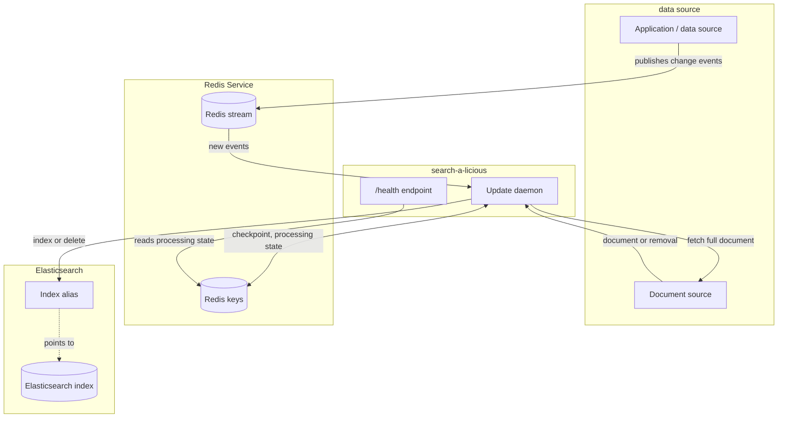
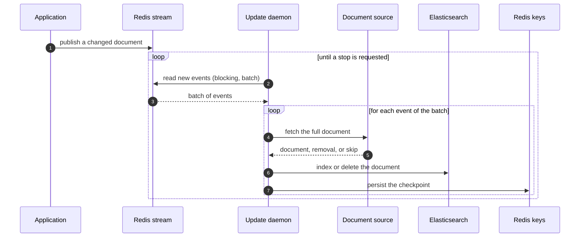
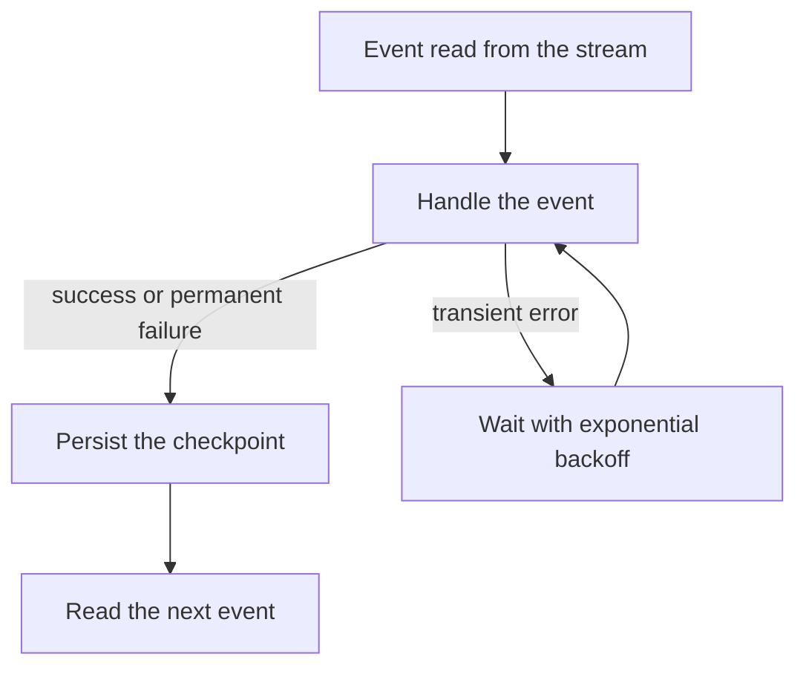
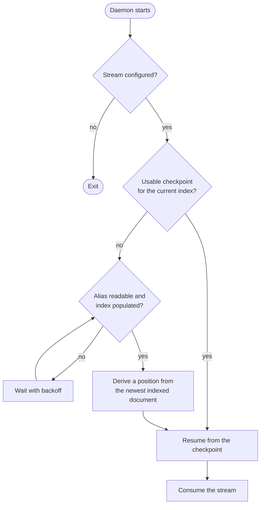
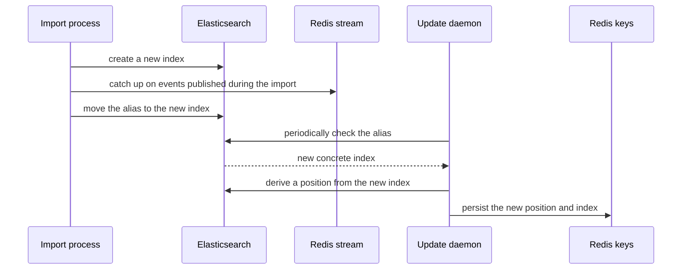

# Explain update daemon

The update daemon keeps an Elasticsearch index up to date **after** the initial import, by consuming a stream of change events.

It does not import whole datasets:
applications publish the documents that changed
to a [Redis stream](https://redis.io/docs/latest/develop/data-types/streams/),
and the daemon reacts to each event
by fetching the current version of the document
and writing it to the index (or removing it).

The daemon is optional and runs as a separate process:
the `updater` service in the provided Docker Compose,
or the `run-update-daemon` command
(see [the Python reference](./ref-python/cli.html#python3-m-app-run-update-daemon)).

For the user point of view (how to publish events, how checkpoints are stored),
see [How to update the index](../users/how-to-update-index.md).
For configuration, see [`redis_stream_name` and `document_fetcher`](../users/explain-configuration.md).

## Overview

The daemon sits between the event stream and the index,
and shares a few helpers with the import process:

The main parts are:

* **the Redis stream**: an append-only log of changes.
  An event carries at least a document ID,
  and may carry more fields used by the document fetcher;
* **the document fetcher**: a project-specific class,
  configured with `document_fetcher`,
  that turns an event into the full document to index;
* **the document processor**: the same preprocessing as the full import
  (configured fields, taxonomies, etc.),
  so the daemon produces the same documents as an import;
* **the index alias**: the daemon writes through the alias;
  imports replace the concrete index behind it;
* **Redis keys**: the daemon persists its position in the stream (checkpoints)
  and an informational processing state, under separate key prefixes;
* **the health endpoint**: reports the processing state,
  without ever making the API unhealthy.

The import process uses the same stream:
during a full import,
the importer catches up with the events published
while it was running, before moving the alias.
The daemon then continues from there.
Both sides share the document fetchers and the low-level stream helpers.

## Main loop

At a high level,
the daemon repeatedly reads a batch of events,
handles each of them,
and records how far it got:

For each event, the daemon:

1. **fetches the current document** through the configured document fetcher.
   Several events may concern the same document;
   the daemon avoids fetching an older event when a newer version was already fetched;
2. **preprocesses it** with the document processor of the index.
   The resulting status decides what happens:
   index the document, delete it, or do nothing;
3. **writes to Elasticsearch**.
   Indexing the same document twice is harmless:
   it only refreshes its indexing timestamp,
   and deleting an absent document is accepted;
4. **persists the checkpoint** in Redis,
   so a restart can resume from the same position.

## Two guarantees

The daemon is built around two properties:
**no lost event** and **no crash on a transient error**.

### No lost event

The position in the stream is persisted only **after** an event has been handled (indexed, removed, skipped, or permanently failed).
On restart, the daemon resumes from the last persisted position,
so events published while it was down are not lost.

If the process crashes between handling an event and persisting its checkpoint,
the event is read again on restart.
This is **at-least-once** processing:
an event may be processed twice, but never silently dropped.
Indexing is idempotent,
so replaying events is safe.

### No crash on a transient error

Elasticsearch and Redis outages are expected:
instead of exiting, the daemon retries transient failures with an exponential backoff,
until the operation succeeds or a stop is requested.
Permanent errors (for example a document that cannot be serialized) do not block the whole stream forever:
they are logged and skipped.
The checkpoint is still advanced,
so such a document is only retried if it changes again.

Persisting the checkpoint is the exception:
a failure there is never silently ignored,
because it would hide a durability problem.

## Startup and resume

The daemon does not always start from an explicit position.
It first tries to reuse its checkpoint,
and otherwise derives a position from the index itself:

Three situations matter:

* **normal restart**: a checkpoint exists for this stream and this index,
  and it is used as the start position;
* **first run, or checkpoint deleted**: the daemon derives a position from the most recent document in the index,
  using the configured `last_modified_field_name`.
  The derived position is persisted immediately;
* **empty index**: there is nothing to derive a position from.
  At startup, the daemon waits, with a backoff, for an import to populate the index,
  instead of skipping the events published until then.

A checkpoint is only valid for the concrete index it was built for.
After a new import, the alias points to a new index,
and a position coming from the previous index could replay or, worse, skip events.
The daemon therefore stores which concrete index each checkpoint belongs to.

## Following a new import

A full import creates a new index,
catches up with the events published during the import,
then moves the alias to the new index.
The daemon notices the swap on its own:

When the daemon detects that the alias moved,
it derives its position again from the newest document of the new index,
persists the new checkpoint and continues from there.
The new position may be **behind** the previous one:
this is intentional,
and the events it covers are simply indexed again.

Because the import catches up before moving the alias,
in practice only a few events are replayed, if any.
If the alias cannot be read (Elasticsearch unavailable),
the daemon logs the failure and keeps indexing from its current position;
the check is retried later.

## Monitoring

The daemon also records an informational processing state in Redis,
separate from the checkpoints:

* the ID of the last event it read;
* the number of read events still to be processed;
* the concrete index it currently sees behind the alias.

The `/health` endpoint reports this state.
It is explicitly **not** part of the resume contract
and never changes the health status of the API:
a stopped daemon does not take the search service out of rotation.
See [Monitoring the update daemon](../users/how-to-update-index.md#monitoring-the-update-daemon)
for the reported fields and how to watch them.

## Specificities

The sections above describe the general behaviour.
The details below matter when debugging or changing the daemon.

### Retry policy

Transient errors are retried forever, with an exponential backoff:

* the first delay is 1 second,
  doubles after each attempt,
  and is capped at 60 seconds;
* a random jitter of ±20% avoids several processes retrying in lockstep;
* waiting is interruptible:
  a stop request does not wait for the current backoff to elapse.

Errors considered transient include:

* Elasticsearch connection errors and timeouts;
* Elasticsearch HTTP responses `429`, `502`, `503`, and `504`;
* status-less transport errors (typically a malformed or unexpected response);
* Redis connection errors, timeouts, and `BUSY` while loading;
* a document fetcher explicitly asking for a retry.

Errors not considered transient include `NotFoundError` and `ConflictError` (document-level errors where retrying the same request will not help),
serialization errors,
and other Redis errors (wrong type, invalid data, etc.).
Those are skipped for event processing,
but a failure to persist a checkpoint is re-raised:
it is a durability problem, not a document problem.

### Reading the stream

The daemon reads up to 100 events per batch,
blocking at most `settings.redis_reader_timeout` seconds
so it can react to a stop request even when the stream is idle.

The in-memory cursor advances as events are read,
but the persisted checkpoint only advances once an event has been handled.
If the reader fails (for example a Redis error during the read)
the generator is rebuilt from the persisted checkpoints,
so the events of the in-flight batch that were not handled yet are read again.

The reader also keeps a bounded cache of recently fetched document IDs,
to avoid refetching a document when several events concern it.
An event is skipped when the same document was already fetched at a later timestamp;
a small safety margin accounts for clock differences between the Redis stream and the daemon.

The daemon code supports several streams,
but the current configuration validation restricts it to a single index (and therefore a single stream).

### Checkpoints and derived positions

Checkpoints are stored under `searchalicious:checkpoint:<stream name>:<index name>`,
and the concrete index they belong to under `searchalicious:checkpoint_index:<stream name>:<index name>`.
The daemon also stores its informational state under `searchalicious:updates_state:<stream name>:<index name>`.

A position derived from the index is a Redis stream ID built from the `last_modified` timestamp,
with sequence `0`.
This deliberately replays events sharing the same millisecond as the most recent indexed document:
replaying is harmless, skipping is not.

### Index swap detection

The alias is checked after each batch has been fully consumed,
including when the read timed out,
so an idle daemon also notices a re-import.
The check is throttled to at most once per minute,
to avoid querying Elasticsearch metadata on every batch of a busy stream.

If resolving the new position fails or yields no verdict,
the daemon keeps its current position and retries at the next check.

### Processing state

The state is written with throttling (at most once every 10 seconds, on the leading edge),
flushed when a batch ends (including on read timeout),
and flushed once more on shutdown,
so that it settles at its final value when the daemon has nothing left to do.
Writing it is best-effort:
failures are logged and never affect indexing.

### Shutdown

`SIGTERM` and `SIGINT` only set a stop event.
The main loop notices it when it comes back from its read timeout or from a retry wait,
then exits cleanly and flushes the processing state.

If a stop happens while an event is being retried,
the event is not indexed and its checkpoint is not advanced:
it will be read again on the next start.
If a stop happens after an event was handled but before its checkpoint was persisted,
the same applies;
the event is replayed, which is safe.

### Code map

* `app/updates.py`: the daemon itself,
  its main loop,
  retries,
  and start position resolution;
* `app/checkpoints.py`: checkpoint keys,
  derived positions,
  and the informational processing state;
* `app/_import.py`: the stream reader used by the daemon (`get_new_updates`),
  the document fetchers,
  and the import-side catch-up (`get_processed_since`);
* `app/indexing.py`: the document processor used by both the import and the daemon;
* `app/health.py`: the `update-daemon-state` health check;
* `app/cli/main.py`: the `run-update-daemon` command.
